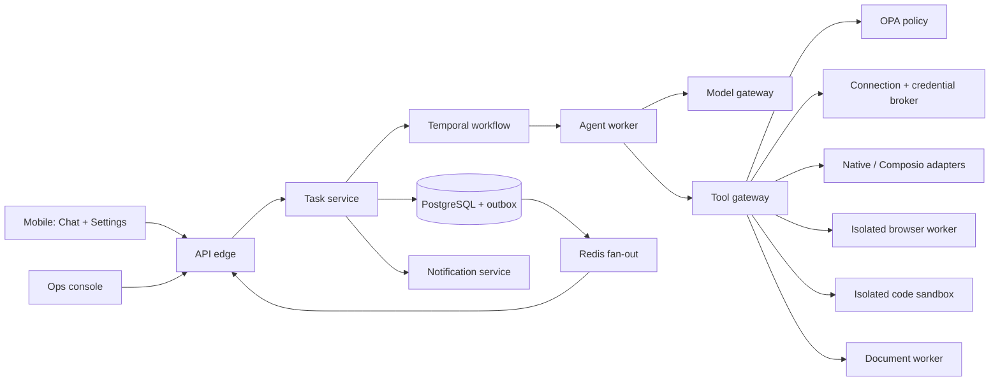

# Signal architecture

## Invariants

- PostgreSQL and Temporal own durable truth; mobile and Redis are caches/fan-out.
- The model proposes; deterministic code validates, authorizes, executes, and verifies.
- Credentials enter only the broker and trusted adapters as short-lived leases.
- Every material action is tied to tenant, principal, task, tool version, connection, policy decision, idempotency key, and action digest.
- An outcome is complete only when mandatory evidence checks pass.

## Protected kernel

`packages/auth-sdk`, `packages/policy-client`, credential storage code, database tenant isolation, audit/evidence hashing, and deployment authority are protected paths. Generated adapters can be created only under `integrations/generated` and cannot import protected implementation modules.

## Local versus production

Local deterministic providers mutate an isolated test state store and emit content-addressed evidence. They are not production provider mocks that pretend to send email or spend money. Production adapters require an explicit connection and return `CONNECTION_REQUIRED` if unavailable.
